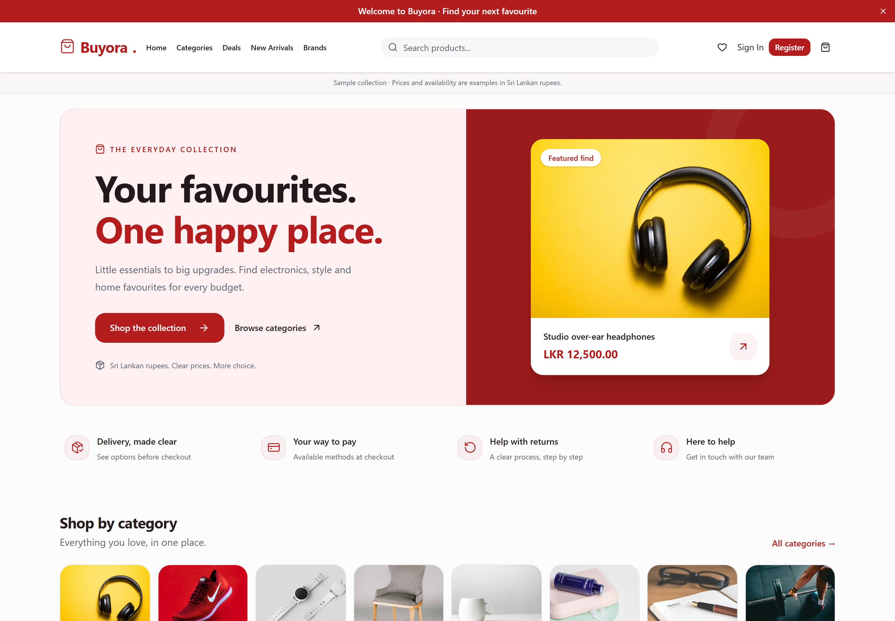
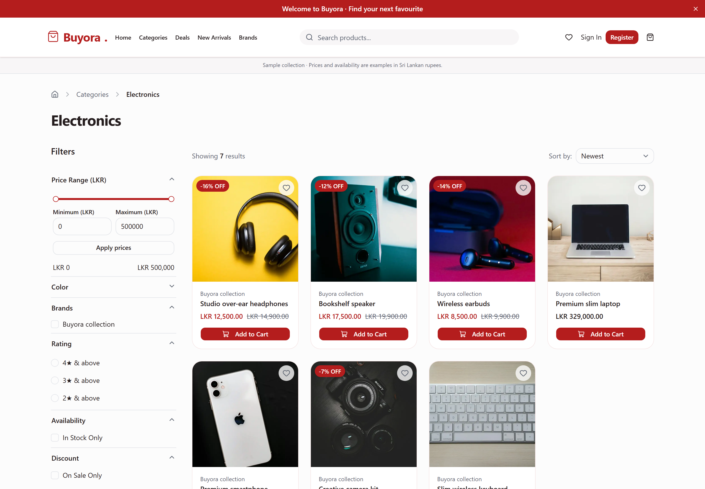
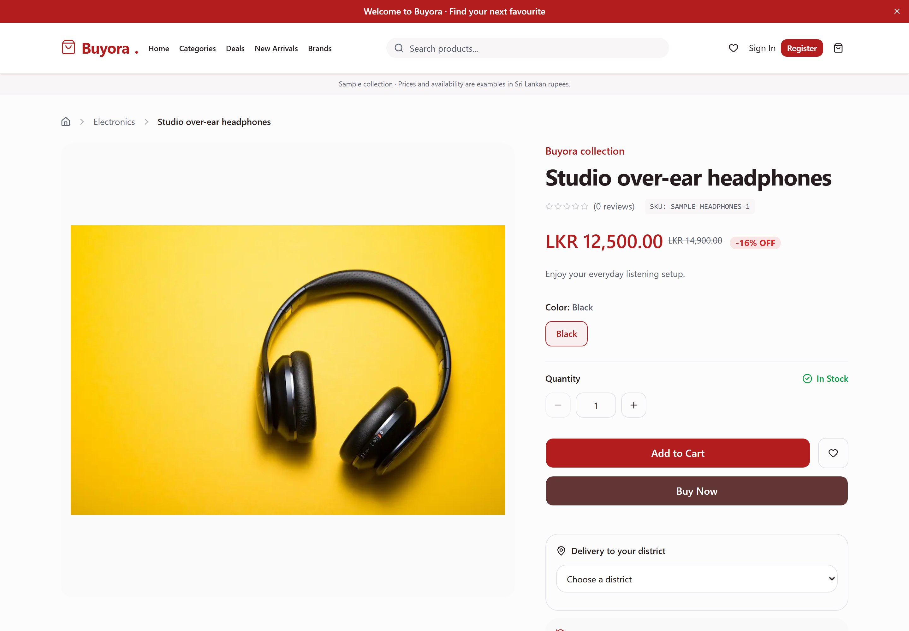
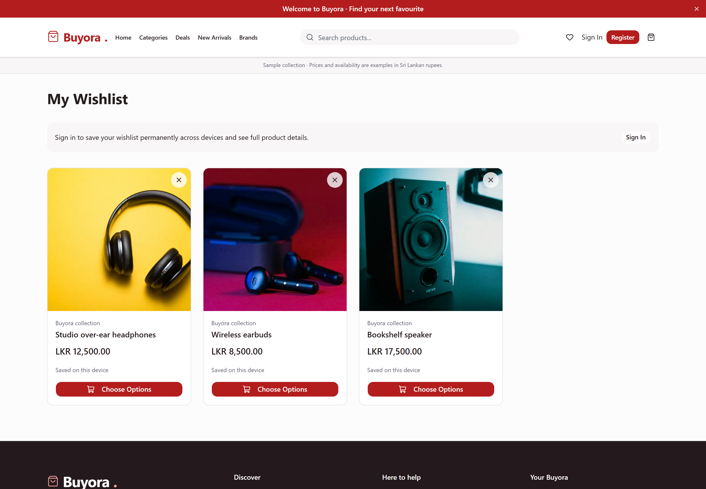
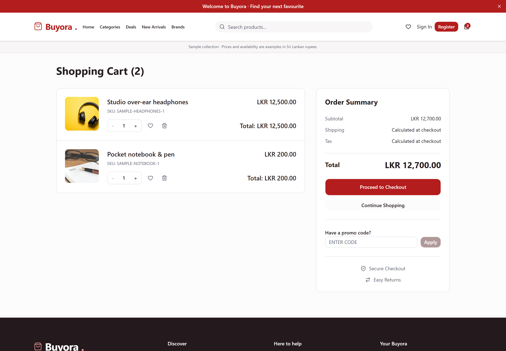
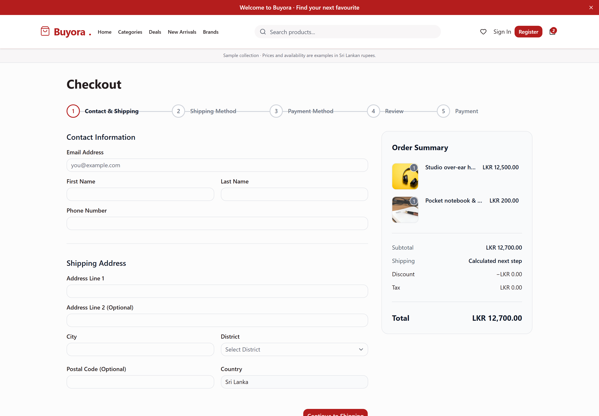
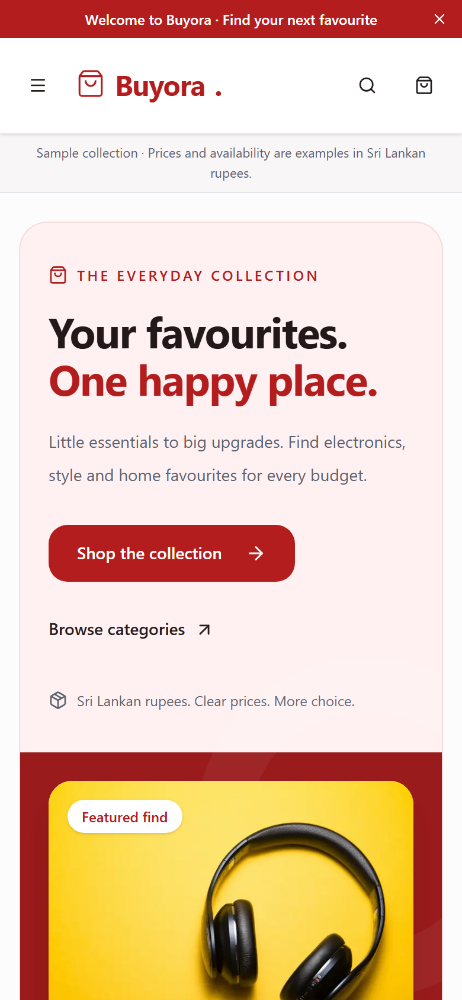
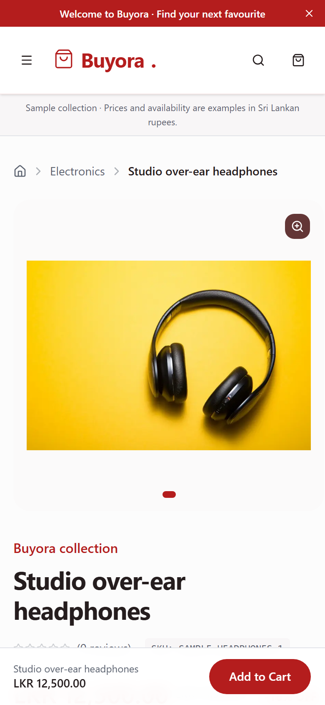

# Buyora screenshot gallery

Screenshots of the running application for the project README, portfolio case studies and presentations. Captured in temporary guest sessions using the local sample catalog and example Sri Lankan rupee prices. The sample notice remains visible in the application.

Click a preview to open its original image. On GitHub, open the image and choose **Download raw file** to save the full-resolution version.

## Desktop

PNG images are captured at 1440 × 1000 with a 2× pixel scale, producing 2880 × 2000 files.

| Storefront | Product discovery |
|---|---|
| [](desktop-home.png) | [](desktop-catalog.png) |
| Red storefront, featured product and category navigation. | Search, LKR prices, product photos, filters and purchase controls. |

### Product details

[](desktop-product.png)

Image gallery, product options, LKR price and stock availability.

| Saved favourites | Shopping cart |
|---|---|
| [](desktop-wishlist.png) | [](desktop-cart.png) |
| A guest wishlist with photographed products. | Product quantities and LKR totals, including an LKR 200 item. |

### Guest checkout

[](desktop-checkout.png)

Contact and shipping fields with an order summary. Fields are blank; no order was placed for the capture.

### Complete storefront

[Open or download the full-page storefront image](desktop-home-full.jpg). This JPEG includes the category collections, budget ranges, offers and footer below the initial viewport.

## Mobile

Captured at a 390 × 844 viewport and 2× scale, producing 780 × 1688 PNG files.

<p>
  <a href="mobile-home.png"></a>
  <a href="mobile-product.png"></a>
</p>

## Portfolio use

- Use `desktop-home.png` as the main project image and `mobile-home.png` alongside it to show responsive design.
- Use the catalog and product images to explain product discovery.
- Use the wishlist, cart and checkout images to show the shopping flow.
- Keep the original PNGs for sharp presentation images; the full-page JPEG is useful for a longer case study.
- Capture metadata and viewport sizes are recorded in [manifest.json](manifest.json). [Product photo sources](../product-photo-sources.json) and [sample catalog details](../SAMPLE_CATALOG.md) are documented separately.

## Refresh after an update

With the frontend dependencies and Playwright Chromium installed and Docker Desktop running, execute these commands from the project root:

```powershell
docker compose -p buyora up -d --wait
node scripts/capture-portfolio.cjs
```

The script detects the running Docker ports and uses Playwright’s bundled headless Chromium. It refreshes the images in this folder and clears its own temporary guest cart when finished. It does not place an order.

Optional environment variables are `SCREENSHOT_PROJECT`, `SCREENSHOT_BASE_URL`, `SCREENSHOT_API_URL` and `PLAYWRIGHT_CHANNEL`. The capture expects the documented sample catalog to be loaded.
